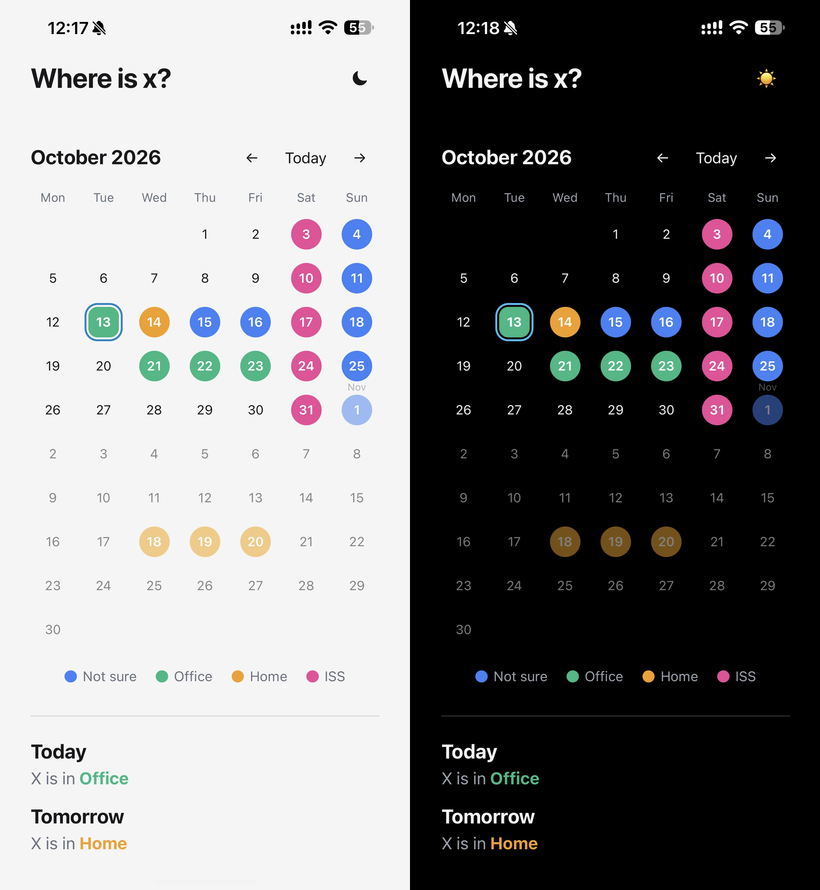

## Where is X?

A simple web calendar to track the location of X.
What is X? X can be a person, a car, or any other object you want to know where it is at what date.

## Simple editing
You can edit the calendar by navigating to /edit then just select the label and select the dates. No saving, no user login required.

## Deployment/Installation
See [Deployment Instructions](./Deployment/ReadMe.md)